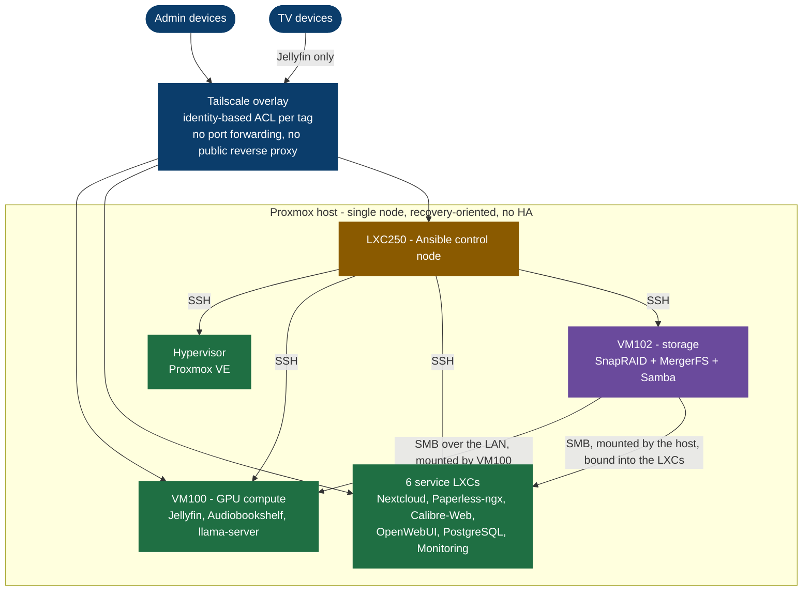

# Homelab Platform Architecture

    

A single-host Proxmox platform with nine guests, reachable only over Tailscale, and every node -
hypervisor and control node included - managed by Ansible. Built and operated by Nicolas
Pogorzelski as a learning platform for DevOps and security engineering, running real services with
real data.

## What this repository shows

- **Configuration management:** 52 playbooks and 47 roles, secrets in Ansible Vault, deployed from a
  control node that refuses to run from a tree that matches no published commit
  ([Ansible](docs/platform/ansible.md)).
- **CI and supply chain:** every push runs the repository validator, ansible-lint and gitleaks over
  the full history; container images are scanned with Trivy and get an SBOM; every action is pinned
  to a commit SHA ([workflows](.github/workflows/)).
- **Zero-trust access:** no public ingress and no port forwarding; identity-based Tailscale ACLs per
  tag, and a LAN guard on every node ([networking](docs/platform/networking.md),
  [ACL model](docs/platform/tailscale-acl.md)).
- **Backup and recovery:** database dumps with monthly automated restore tests, weekly guest
  backups, recovery runbooks ([backup flow](docs/architecture/backup-flow.md)).
- **Monitoring:** Prometheus, Grafana and Alertmanager, with alert rules covered by promtool unit
  tests ([monitoring](docs/platform/monitoring.md)).
- **Security assessment:** an ISO/IEC 27001 Annex A mapping that separates enforced controls from
  practices - a self-assessment, not a compliance claim
  ([security controls](docs/platform/security-controls.md)).

## At a glance

Arrows follow what is delivered: requests to services, storage to the node that mounts it,
configuration to the node it configures. No device reaches a node over the LAN; the only LAN paths
left are SMB from vm100 and the hypervisor to vm102, break-glass SSH to the hypervisor, and
netconsole from vm100 to the hypervisor.

High availability is not a goal on a single host. The design invests in recovery instead: modelled
dependencies, tested restores and a runbook per failure. All copies are on site today; the off-site
copy is the first item of the [remediation plan](docs/platform/remediation-plan.md).

## Where to start

| To see | Read |
|---|---|
| How it is built and why | [Design decisions](docs/decisions/design-decisions.md), then the [architecture diagram](docs/architecture/diagram.md) |
| How it is run and what has broken | [Known errors](docs/platform/known-errors.md) and the [remediation plan](docs/platform/remediation-plan.md) |
| How it is secured, and where it is not | [Security controls](docs/platform/security-controls.md) and [data classification](docs/platform/data-classification.md) |
| One decision end to end | [SMB bind and LAN access](docs/decisions/smb-bind-and-lan-access.md) |

## How this repository is built

The platform is designed, built and operated by Nicolas Pogorzelski, with the help of an LLM-based
coding assistant (Claude Code). It is used for research (locating and summarising official
documentation), for explaining concepts and commands, for reviewing configuration, and for drafting
changes and the documentation. Code for a new topic is written by hand first and reviewed
afterwards. Every change is reviewed before it is committed, every decision recorded in the
decision records can be explained by the author, and every change reaches `main` through a pull
request that the author opens and merges, with the validator, ansible-lint, gitleaks and the
commit-message check green. The rules the assistant works under are in [CLAUDE.md](CLAUDE.md), with
its project hooks, review agents and the hand-started `start-scan` skill in `.claude/`;
documentation conventions are in
[CONVENTIONS.md](docs/CONVENTIONS.md).

## Documentation

### Architecture

- [Overview](docs/architecture/overview.md)
- [Logical architecture](docs/architecture/diagram.md) - access policy, storage, monitoring coverage
- [Failure domains](docs/architecture/failure-domains.md) - what fails with which disk
- [Backup and recovery](docs/architecture/backup-flow.md) - what is copied, and what is not
- [Exposure model](docs/architecture/exposure-diagram.md)

### Decisions

18 decision records; the [design decisions](docs/decisions/design-decisions.md) collect the
foundational ones.

- [SMB bind and LAN access](docs/decisions/smb-bind-and-lan-access.md) - [Media over the tailnet](docs/decisions/media-over-the-tailnet.md) - [Loopback + Tailscale Serve](docs/decisions/loopback-tailscale-serve.md) - [sshd binding](docs/decisions/sshd-listen-address.md)
- [PostgreSQL boot ordering](docs/decisions/postgresql-tailscale-boot-ordering.md) - [pveproxy boot ordering](docs/decisions/pveproxy-tailscale-boot-ordering.md) - [MagicDNS and systemd-resolved](docs/decisions/magicdns-and-systemd-resolved.md) - [LXC200 systemd visibility](docs/decisions/lxc200-systemd-visibility.md)
- [Hypervisor panic policy and softdog](docs/decisions/hypervisor-panic-and-watchdog.md) - [Calibre auto-import on CIFS](docs/decisions/calibre-cifs-sqlite-import.md) - [LXC250 control node](docs/decisions/lxc250-devops.md) - [Off-site backup target](docs/decisions/offsite-backup-target.md) - [Vaultwarden decommissioning](docs/decisions/vaultwarden-decommission.md) - [Headscale migration](docs/decisions/headscale-migration.md) - [Identity before Terraform](docs/decisions/identity-before-terraform.md) - [Controls built to be learned](docs/decisions/exercise-scope-before-terraform.md) - [Scratch pool on the former boot SSD](docs/decisions/scratch-pool-on-former-boot-ssd.md)

### Security, risk and operations

- [Security controls](docs/platform/security-controls.md) - ISO/IEC 27001 Annex A mapping
- [Data classification](docs/platform/data-classification.md) - recovery objectives per dataset
- [Physical and environmental controls](docs/platform/physical-controls.md)
- [Remediation plan](docs/platform/remediation-plan.md) - open work, ranked by risk
- [Known errors](docs/platform/known-errors.md) - root-caused faults and their fixes
- [Operations](docs/platform/operations.md) - dependency layers and maintenance
- [HA mechanics](docs/platform/ha-mechanics.md) - what Proxmox HA would do here, and why it stays off
- Incidents: [aux-disk failure](docs/platform/incidents/2026-06-25-aux-disk-failure-and-recovery.md), [vm100 silent freeze](docs/platform/incidents/2026-07-11-vm100-silent-freeze.md)

### Platform

- [Proxmox host](docs/platform/proxmox-host.md) - [Ansible](docs/platform/ansible.md) - [Monitoring](docs/platform/monitoring.md) - [Networking](docs/platform/networking.md) - [Tailscale ACL](docs/platform/tailscale-acl.md)
- [Storage design](docs/platform/storage-design.md) - [Samba](docs/platform/samba.md) - [Storage permissions](docs/platform/storage-permissions.md)
- [Ansible inventory example](ansible/inventory/hosts.yml.example) - [Repository validator](scripts/validate-repo.sh), 46 checks
- [Documentation conventions](docs/CONVENTIONS.md)

### Runbooks, nodes and services

23 runbooks, each with preconditions, verification, failure modes, rollback and the date it was last
exercised. Index: [runbooks/README.md](runbooks/README.md).

Nine node documents and eight service documents

- Nodes: [vm100](docs/nodes/vm100.md) - [vm102](docs/nodes/vm102.md) - [lxc200](docs/nodes/lxc200.md) - [lxc210](docs/nodes/lxc210.md) - [lxc211](docs/nodes/lxc211.md) - [lxc220](docs/nodes/lxc220.md) - [lxc230](docs/nodes/lxc230.md) - [lxc250](docs/nodes/lxc250.md) - [lxc260](docs/nodes/lxc260.md)
- Services: [Jellyfin](docs/services/jellyfin.md) - [Audiobookshelf](docs/services/audiobookshelf.md) - [Nextcloud](docs/services/nextcloud.md) - [Paperless-ngx](docs/services/paperless.md) - [Calibre-Web](docs/services/calibre-web.md) - [OpenWebUI](docs/services/openwebui.md) - [LLM inference](docs/services/llm-inference.md) - [PostgreSQL platform](docs/services/postgresql-platform.md)

## Roadmap

| Phase | Topic | Status |
|---|---|---|
| 1-5 | Linux, Docker, monitoring, Tailscale ACLs, Ansible ([learning log](https://github.com/NicolasPogorzelski/devops-til/blob/main/ansible/homelab-ansible-track.md)) | Done |
| 5.5 | Identity: LDAP directory and OIDC provider ([decision](docs/decisions/identity-before-terraform.md)) | Planned |
| 6 | Terraform: AWS free tier and Proxmox provisioning | Planned |
| 7 | Kubernetes: k3s | Planned |
| 8 | AWS depth and Python | Planned |
