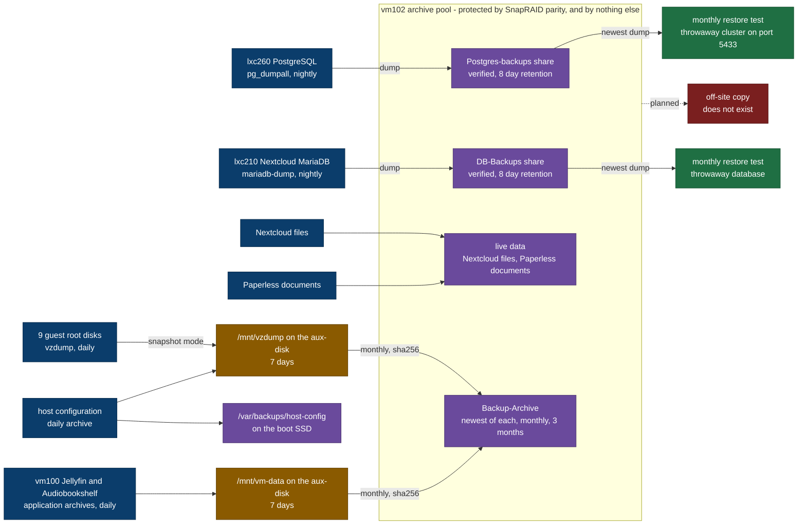

# Backup and Recovery Flow

What is copied, to where and how often, and what is not copied at all. Arrows follow the payload:
a dump moves from the database that produced it to the share that stores it. Schedules are in the
role defaults (`postgresql_backup`, `mariadb_backup`, `guest_backup`, `app_backup`,
`backup_mirror` and the restore-test roles).

Red marks the copy that does not exist yet, the
[off-site backup](../platform/remediation-plan.md#off-site-backup). Orange marks copies on the
failing aux-disk ([KE-13](../platform/known-errors.md#ke-13)).

## What the Picture Shows

Both database chains are verified at write time. Each dump is written under a `.partial` name
and renamed only after three checks pass: non-empty, `gzip -t`, and exactly one completion marker.
The marker check is the one that catches a dump killed halfway, which is still valid gzip. The
checks run before the retention delete, so a failed run never removes the last good dump.

Both chains are restored monthly. The PostgreSQL dump goes into a throwaway cluster on port 5433,
the MariaDB dump into a throwaway database; neither touches the live database. Results feed
`PostgreSQLRestoreTestStale` and `MariaDBRestoreTestStale`.

Backups run in two tiers. The short-term tier is daily and sits on the aux-disk: `guest_backup`
writes a `vzdump` of all nine guests to `/mnt/vzdump`, lxc250 first, and keeps seven days. vm100
contributes its root disk only; its `jellyfin-data` disk carries `backup=0`, so `app_backup` writes
Jellyfin's own archive (database and subtitles) through its API onto that disk, and Audiobookshelf
writes its archive there on its own schedule. The host's configuration
is archived daily to the same disk and to the boot SSD, so either survives the loss of the other
([platform restore](../../runbooks/platform/platform-restore.md)).

Verified 2026-08-21: a guest restored from its vzdump archive, by the
[guest backup runbook](../../runbooks/platform/guest-backup-restore.md).

The long-term tier is monthly. `backup_mirror` on the host and on vm100 copies the newest archive
of each guest and application into the Backup-Archive on vm102, checks every copy by sha256 and
keeps three months. It is the copy that survives the aux-disk
([KE-13](../platform/known-errors.md#ke-13)); its restore point is up to a month old
([backup archive runbook](../../runbooks/platform/backup-archive.md)).

Nothing is copied off site. Every arrow ends inside the building. The archive pool holds the
backups and the primary data of two services, so fire, theft or encryption takes originals and
copies together. What exists elsewhere is point in time: this repository, the escrowed Ansible
secrets, and the irregular disk copies listed in
[data classification](../platform/data-classification.md), none of which covers the archive pool.
The `offsite_backup` role exists; its target is not provisioned.

## What Parity Does Not Cover

Everything inside the vm102 box, dumps included, is protected by SnapRAID parity against a failed
disk, and against nothing else. Parity does not reconstruct a
file deleted, truncated or encrypted before the next `snapraid sync`, because that sync writes the
damage into the parity.

A file that changes while the sync reads it leaves parity inconsistent for that block
([KE-19](../platform/known-errors.md#ke-19)). SQLite side files (`*-shm`, `*-wal`) and other
volatile paths are therefore excluded in `snapraid_maintenance` defaults.

## The Guards and Their Shared Blind Spot

| Alert | Fires when | Blind to |
|---|---|---|
| `PostgreSQLBackupStale` | no verified dump for 25 h | an outage in which the host is off |
| `MariaDBBackupStale` | the same, for lxc210 | the same |
| `PostgreSQLRestoreTestStale` | no successful restore test for 40 days | - |
| `MariaDBRestoreTestStale` | the same, for MariaDB | - |
| `DatabaseBackupMetricsMissing` | a backup or restore-test timestamp is absent | - |
| `GuestBackupStale` | last guest backup run too old | - |
| `GuestBackupPartial` | at least one guest failed in the last run | - |
| `HostConfigBackupStale` | the host configuration archive is too old | - |
| `AppBackupStale` | a Jellyfin or Audiobookshelf archive on vm100 is too old | - |
| `BackupMirrorStale`, `BackupMirrorFailed` | no verified monthly copy, or the last run failed | - |

Thresholds are in [monitoring](../platform/monitoring.md). Prometheus runs on the host that powers
down every night: during a multi-day outage there is no scrape, and at the next boot the timer's
`Persistent=true` catch-up refreshes the timestamp before anything is evaluated. The backup rules
therefore mean "no more than 25 hours of uptime without a dump". Host-off periods are the job of the
[external heartbeat](../platform/remediation-plan.md#external-heartbeat).

## Related

- [Failure domains](failure-domains.md) - which disk takes which dataset with it
- [Data classification](../platform/data-classification.md) - class and recovery objective per dataset
- [PostgreSQL backup](../../runbooks/database/pg-backup.md), [restore](../../runbooks/database/pg-restore.md), [MariaDB backup](../../runbooks/database/mariadb-backup.md)
