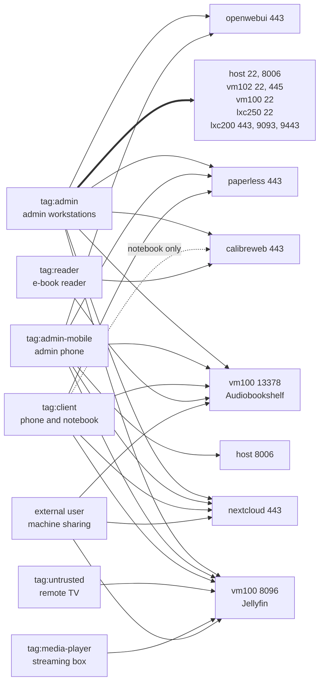
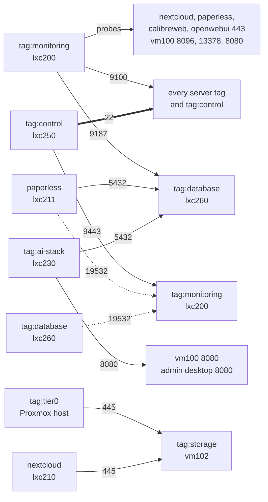
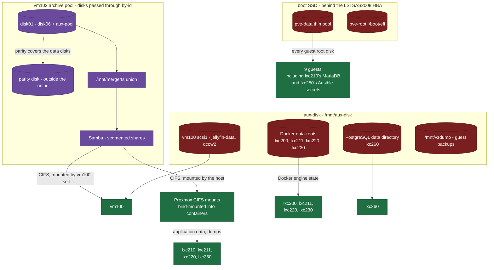

# Infrastructure Architecture - Logical View

Three views: who may reach whom, where the bytes live, and what is watched. Failure and backup have
their own views: [failure domains](failure-domains.md) and [backup and recovery](backup-flow.md).

## Reading the Arrows

An arrow follows what is delivered: a request to the service it reaches, bytes to their consumer,
metrics to the collector. Where the connection opens the other way, the view says so (View 3,
because Prometheus pulls). A dotted arrow delivers nothing: parity protection, or an exercise path.
A component drawn inside a box runs inside it. Node names match the inventory.

## View 1 - Access Policy

Every arrow is a grant from [`tailscale-acl.md`](../platform/tailscale-acl.md) with its ports; here
the arrow is the request. Most grants name a host rather than a tag, because `tag:tier1` holds three
services. A service box stands for one host, a tag box for every node carrying the tag.

### 1a - Access by people and devices

The dotted arrow is a grant with a narrower source: the client notebook's address, not the tag.
`tag:isolated` has no rule. No rule has a person's device as destination, except the inference
backend on the admin desktop in 1b.

### 1b - Service to service, and monitoring

The dotted arrows are the journal upload, an [exercise](../decisions/exercise-scope-before-terraform.md).
`tag:storage` and `tag:tier2` never appear as a source: vm102 and vm100 initiate nothing over the
tailnet (vm100 mounts its media over the LAN), and ACLs are deny-by-default. Port 9100 shows that a
machine is alive; the probes show that the service on it answers
([KE-8](../platform/known-errors.md#ke-8)).

## View 2 - Where the Bytes Live

Three storage layers. Only the archive pool has parity; the other two carry the root disks, the
Docker state and the PostgreSQL data on single disks, both with open faults.

vm100 mounts CIFS itself; the containers never do. The host mounts the shares and bind-mounts them
into the containers, so a failed host mount appears inside a container as an empty directory
([KE-15](../platform/known-errors.md#ke-15)).

The two container groups differ: lxc210 and lxc260 receive CIFS data but run no Docker; lxc200 and
lxc230 run Docker but have no CIFS mount. Loss per disk is therefore asked per node.

Red marks hardware with an open fault: the boot SSD logs transport-layer I/O errors
([KE-14](../platform/known-errors.md#ke-14)), and the aux-disk has a growing count of unreadable
sectors ([KE-13](../platform/known-errors.md#ke-13)). See [failure domains](failure-domains.md).

## View 3 - Monitoring Coverage

Prometheus on lxc200 scrapes the jobs rendered from
`ansible/roles/prometheus_config/templates/prometheus.yml.j2`. Metrics flow to lxc200; the connection
opens the other way, as the monitoring grants in View 1.

| Exporter | Where | Adds |
|---|---|---|
| node_exporter, systemd unit on the Tailscale address | every node | `node_systemd_unit_state`, apt and listener metrics |
| textfile collectors | host, vm102, vm100 | SMART, LVM thin pool, guest and host-config backup; SnapRAID, storage permissions; CUDA watchdog |
| node_exporter, Docker container on loopback | lxc200 | resources only, no systemd units |
| postgres_exporter | lxc260 | `pg_stat_*`, `pg_up` |
| blackbox_exporter | lxc200 | three HTTP probes on vm100, four HTTPS probes behind `tailscale serve` |

`SystemdUnitFailed` covers all ten nodes. On lxc200 the container exporter cannot see the node's
systemd, so a second, native exporter on 9101 reports it
([decision](../decisions/lxc200-systemd-visibility.md)).

The policy is enforced by the Tailscale ACL, not by these diagrams. Where they disagree with the
admin console, the console is the source of truth.
