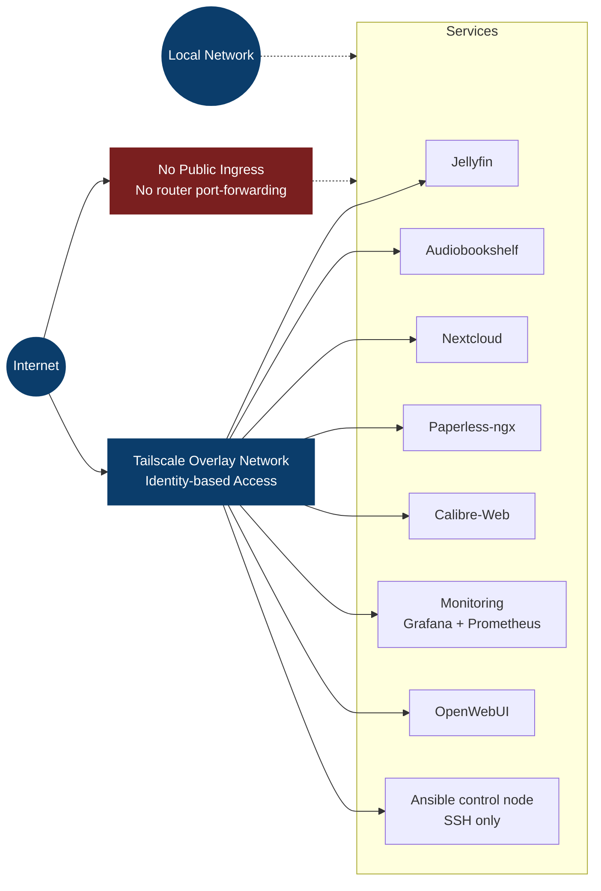

# Infrastructure Exposure Model

This diagram shows how services are accessed and how public ingress is prevented.

**Reading the arrows:** a solid arrow is a path that reaches a service. A dotted arrow is one that
does not exist - it marks an absent ingress, not a restricted one.

This page answers "what is reachable from where". For "which rule allows it, on which port", see
[View 1 of the logical architecture](diagram.md#view-1---access-policy), which draws the ACL itself.

## What the diagram does not show

The diagram is accurate at the network boundary. It is not a statement about how each service binds.

The binding rule ([networking](../platform/networking.md)) is: bind the Tailscale address, or bind
loopback and publish through `tailscale serve`. These listeners do not follow it:

| Node | Listener | Why | Recorded in |
|---|---|---|---|
| Proxmox host | sshd `*:22` | the only path in without Tailscale, unpinned by decision | [sshd decision](../decisions/sshd-listen-address.md) |
| Proxmox host | netconsole receiver, UDP 6666 | netpoll cannot use a Tailscale address | [Proxmox host](../platform/proxmox-host.md) |
| lxc210 | Apache `*:80`, `*:443` | deferred | [remediation plan](../platform/remediation-plan.md#open-items) |
| lxc210 | Collabora `*:9983` | no listen-address setting; `nft_guard` allows loopback only | [Nextcloud](../services/nextcloud.md) |
| vm102 | Samba `0.0.0.0:445` | Samba cannot bind `tailscale0`; `smb_guard` filters it | [SMB bind decision](../decisions/smb-bind-and-lan-access.md) |

sshd binds the Tailscale address on all nine guests; vm100 and vm102 were the last, pinned on
2026-10-12. `listener_metrics` exports every listener outside the rule that the inventory does not
allow on record, and `ListenerOutsideBindingRule` fires on it.

What keeps the LAN out is the `lan_guard` nftables table on every node, in place since 2026-10-01.
It drops new inbound LAN connections except DHCP, Tailscale's own UDP port, SMB to vm102 from vm100
and the hypervisor, and break-glass SSH and netconsole to the hypervisor. The router's missing
forwarding rules keep the internet out.
