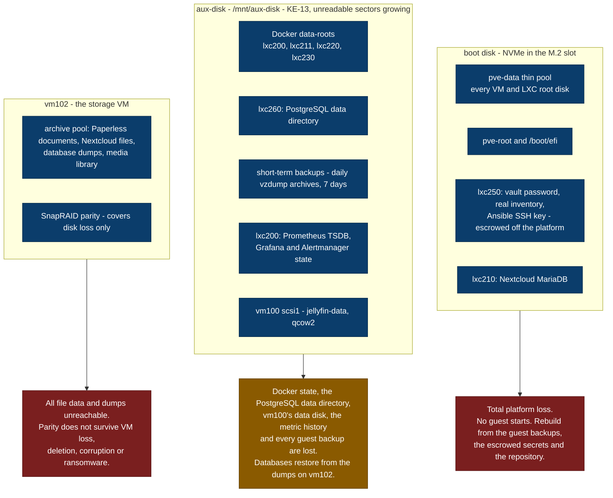

# Failure Domains - What Dies With What

If a piece of hardware fails, what fails with it. Containment is ownership: what a device carries is
drawn inside it. Unlike the other views, the arrows here follow loss: "if the source fails, this is
the consequence".

None of the three domains is redundant. The platform has no high availability; recovery is
procedural.

## The Three Domains

## What Each Domain Means in Practice

**Boot disk.** It carries `/boot/efi`, `pve-root` and the whole `pve-data` thin pool, so every root
disk on the platform. It is an NVMe drive on PCIe; the former boot SSD, whose `DID_SOFT_ERROR`
bursts on the SAS HBA are [KE-14](../platform/known-errors.md#ke-14), stays fitted outside the
volume group ([proxmox-host.md](../platform/proxmox-host.md#boot-disk)).

Two [C1](../platform/data-classification.md) datasets sit on it: lxc250's Ansible secrets and
Nextcloud's MariaDB. MariaDB has a nightly verified dump on vm102 and a monthly restore test. The
secrets are escrowed in an external password manager and on paper; the escrow has
not been restored from ([escrow drill](../platform/remediation-plan.md#escrow-restore-drill)). The
host's own configuration is archived daily to the aux-disk and to the boot disk.

**aux-disk.** In service with a growing count of unreadable sectors
([KE-13](../platform/known-errors.md#ke-13) holds the measurements). `smartctl -H` reports PASSED
regardless, because `Current_Pending_Sector` cannot trip the self-assessment;
`SmartAttributeDegrading` watches the raw counts instead.

- Docker images and state: class C3, rebuildable from the compose files.
- PostgreSQL data directory: recovered from the newest nightly dump on vm102.
- Monitoring history: no backup.
- vm100's `jellyfin-data`: qcow2, so vm100 can be snapshotted; the snapshots of this disk live
  here, those of its system disk in the boot disk's thin pool, and they cover a bad change, not
  the disk's loss. The disk is excluded from the guest
  backup.
- `/mnt/vzdump` and the application archives on `jellyfin-data`: the short-term backups share this
  disk with the state they would rebuild; the monthly Backup-Archive on vm102 is the copy that
  survives it ([backup and recovery](backup-flow.md)).

Replacement: [aux-disk replacement](../platform/remediation-plan.md#aux-disk-replacement-and-disposal).

**vm102.** SnapRAID computes parity over the present contents of the data disks. It reconstructs a
failed disk. It does not reconstruct a file deleted, truncated or encrypted before the next
`snapraid sync`, because that sync writes the damage into the parity. Against site loss it is worth
nothing: the parity disk is in the same machine. Each dataset's protection is drawn in
[backup and recovery](backup-flow.md).

## What Is Not a Failure Domain

The Proxmox host is a single point of failure - one machine, no cluster - but its loss is a hardware
problem and no data problem: the guests live on the disks above. A dead mainboard costs a
replacement and a rebuild ([platform restore](../../runbooks/platform/platform-restore.md)); a dead
boot SSD rolls every guest back to its last daily backup and each database to its last nightly dump.

## Related

- [Storage design](../platform/storage-design.md) - the layout these domains are cut from
- [Data classification](../platform/data-classification.md) - what each dataset is worth
- [Backup and recovery](backup-flow.md) - what protection exists per dataset
- [Remediation plan](../platform/remediation-plan.md) - the ordering of the work
